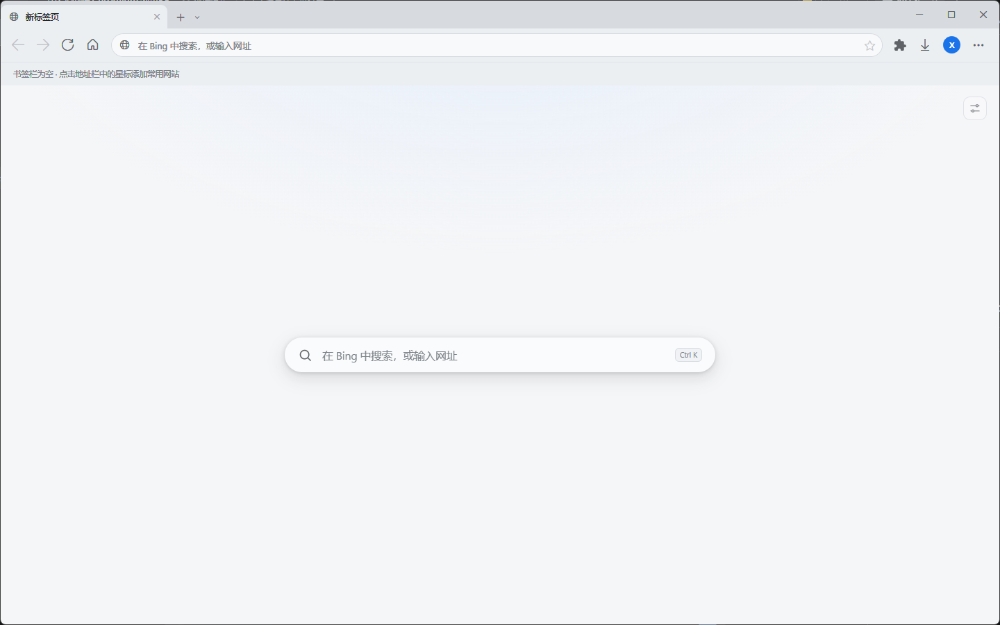
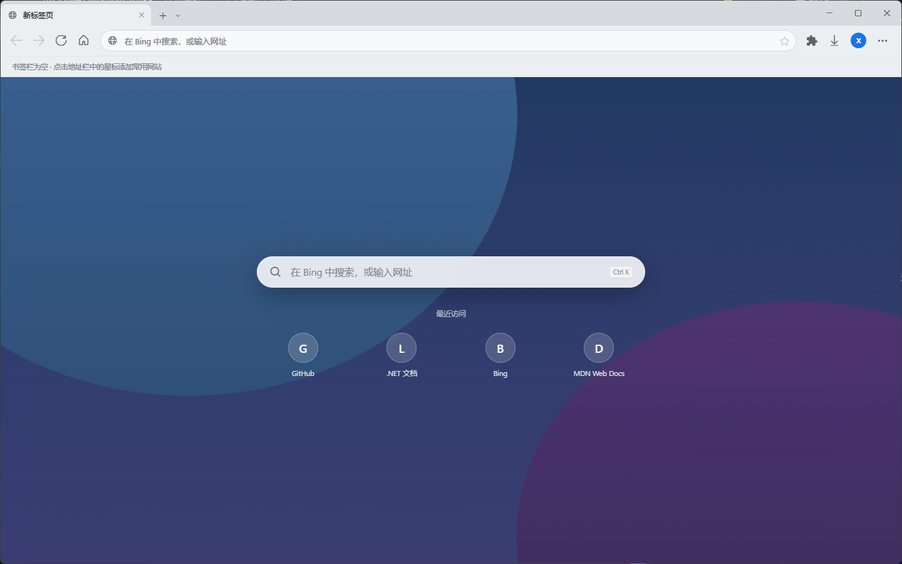
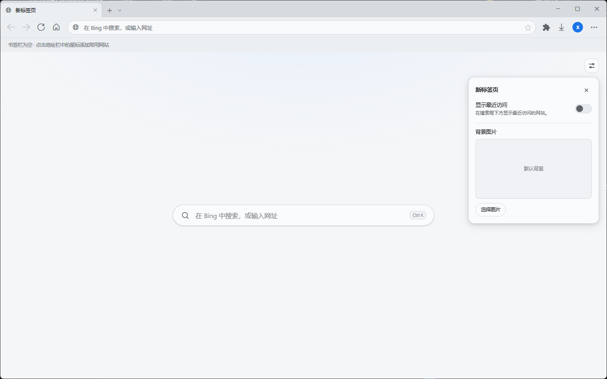
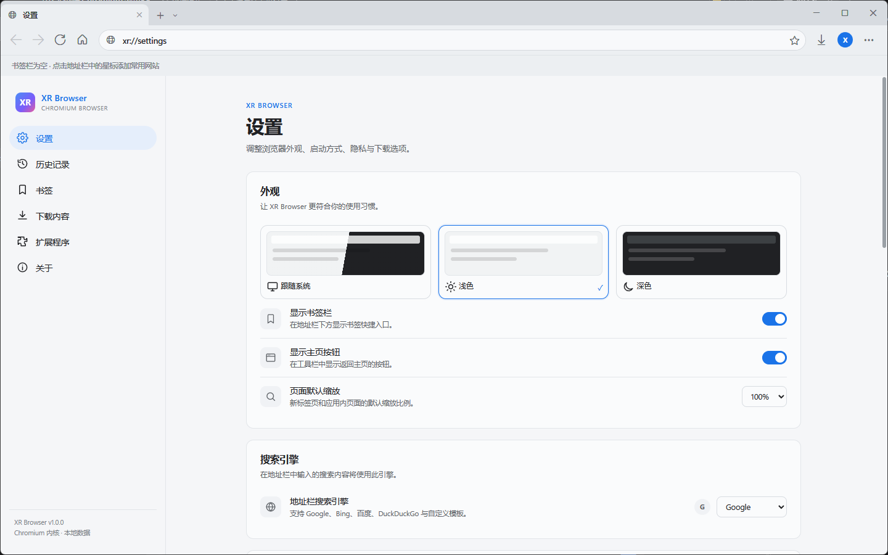
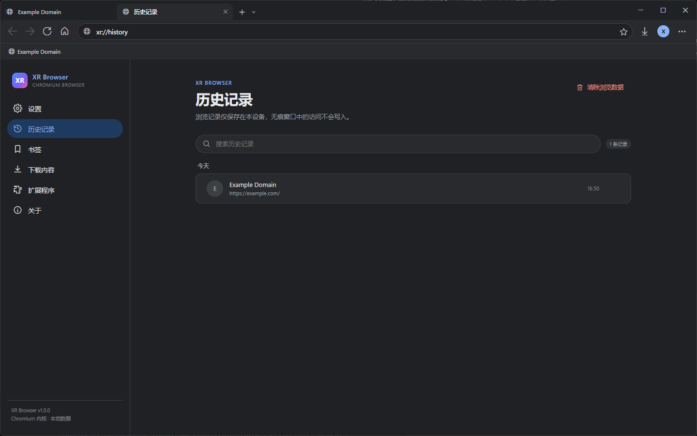
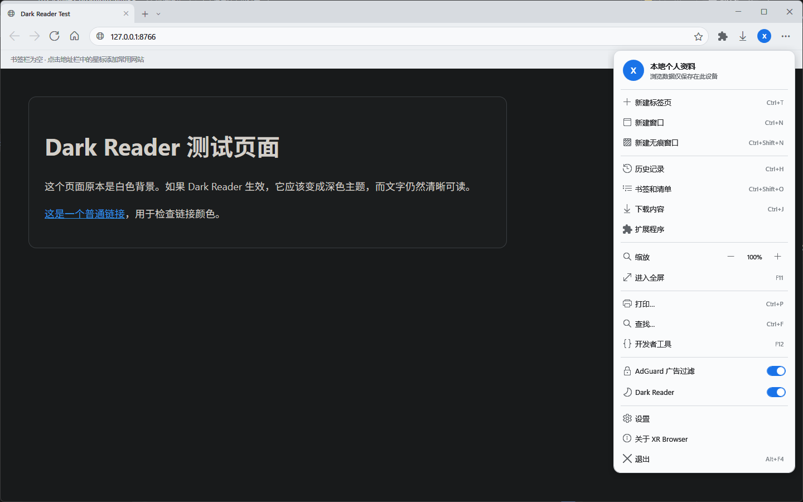
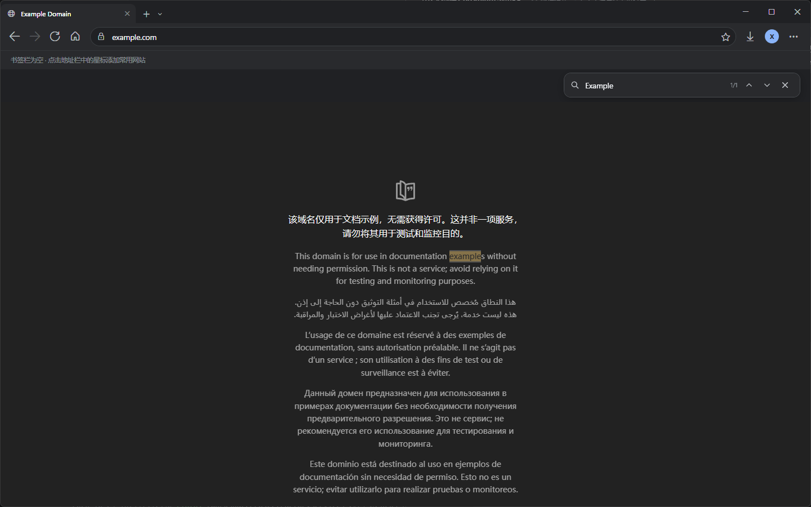
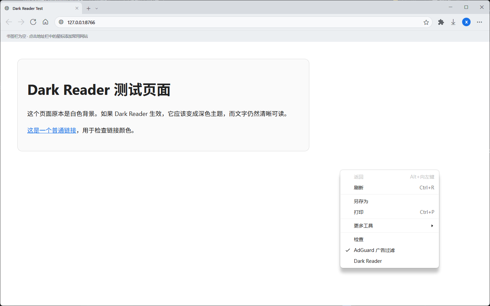
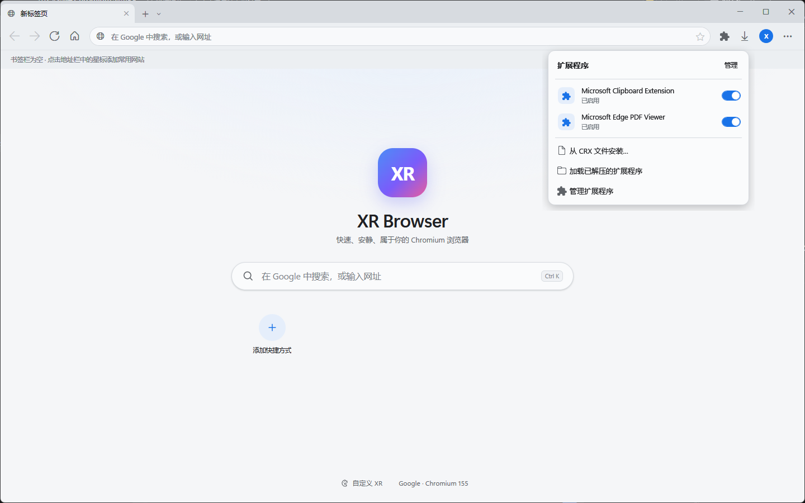

# XR Browser

[简体中文](README.md) | **English**

A Windows desktop browser built with **C# / .NET 8 / WPF / Chromium (Microsoft Edge WebView2)**. The UI follows Chrome's information hierarchy and interaction patterns while keeping native Windows window dragging, resizing, snapping, and DPI support.

## Install

Double-click the installer:

[XR-Browser-Setup-1.0.0.exe](dist/XR-Browser-Setup-1.0.0.exe)

It is a standard graphical setup wizard. By default it installs for the current user, so no command-line arguments are required.

## Features

### Browsing

- Chromium engine via the WebView2 Evergreen Runtime, with modern web support, PDF preview, and Chrome DevTools.
- Multiple tabs: create, close, reopen closed tabs, mute, duplicate, drag to reorder, and overflow scrolling.
- Chrome-style tab strip, toolbar, collapsible bookmarks bar, floating address suggestions, and download flyout.
- The address bar handles both URLs and searches: Bing is the default, with local history/bookmark suggestions and support for Google, Bing, Baidu, DuckDuckGo, Yandex, and custom search templates.
- URL input correction: fixes full-width punctuation and malformed input such as `https:\\` or `https//`.
- Minimal new tab page: just a search box by default; the top-right settings button can enable recent sites or choose a local image as the background.
- Home, back/forward, reload/stop, page zoom, print, find in page, and fullscreen.
- Session restore: reopens tabs and window position after a normal exit.
- Multiple windows and incognito windows: incognito uses WebView2's off-the-record profile and does not write history.

### Data and management

- Bookmarks: star a page, bookmarks bar, built-in bookmark manager, and open/edit/delete from the context menu.
- History: grouped by date, searchable, single-entry deletion, and bulk clearing; incognito windows are not recorded.
- Downloads: progress, pause/resume/cancel, open file, show in folder, download flyout, and download page.
- Permission prompts for camera, microphone, location, notifications, clipboard, autoplay, and more.
- Browsing data clearing: history, cookies, cache, passwords, autofill, and download records; supports clearing data for the current site.
- AdGuard-style ad blocking: uses AdGuard Base and Chinese filter lists to block ads and tracking requests and hide common ad elements; can be toggled from the main menu, page context menu, and settings.
- Dark Reader: bundled Dark Reader 4.9.133 applies a dark theme to pages without changing the browser UI; can be toggled from the main menu, page context menu, and settings.
- UI animation: tabs and flyouts use interruptible damped springs (low latency, slight overshoot, continuous handoff) with velocity-driven motion blur. Switching tabs slides a shared accent background behind the active tab with a subtle stretch-and-settle effect. Menu buttons close on a second click, and menus scale back toward their trigger. Can be disabled or slowed in Settings → Appearance.
- Tab tear-off: drag a tab outside the tab strip to create an independent window near the cursor. The new window reloads the current URL; WebView history and form state are not transferred.
- Title bar: kept opaque to avoid black or broken material effects with transparent title bars under different DWM/wallpaper configurations.
- Frosted flyouts: popup menus and the page context menu use a pre-open screenshot with two-pass Gaussian blur and a light highlight; material opacity is adjustable.
- Context menu: the page context menu is a custom WPF menu with open/close animation and a blurred backdrop instead of Chromium's native menu.
- Extensions: the toolbar puzzle menu lists, enables, and disables extensions; supports installing local CRX2/CRX3 files or unpacked Chromium extensions, and removing extensions in Settings (subject to WebView2 extension support).
- Settings persist to local JSON; system, light, and dark themes are supported.

### Internal pages

Available from the address bar:

| Address | Content |
| --- | --- |
| `xr://newtab` | New tab page (search and recent sites) |
| `xr://settings` | Settings |
| `xr://history` | History |
| `xr://bookmarks` | Bookmark manager |
| `xr://downloads` | Downloads |
| `xr://extensions` | Extensions |
| `xr://about` | Version, engine, and feature overview |

## Screenshots

| New tab | New tab with background |
| --- | --- |
|  |  |

| New tab settings | Settings page |
| --- | --- |
|  |  |

| History | Main menu |
| --- | --- |
|  |  |

| Find in page | Page context menu |
| --- | --- |
|  |  |

| Extensions |
| --- |
|  |

> The frosted menu backdrop is a screenshot taken before the menu opens and blurred with a Gaussian filter. It is a static backdrop; page animations continue underneath but the blurred layer does not refresh frame by frame.

## Quick start

A prebuilt build is available at:

```text
dist\XR Browser\XR.exe
```

Double-click `XR.exe`. First run requires:

1. Windows 10 1809+ or Windows 11 (x64).
2. [.NET 8 Desktop Runtime](https://dotnet.microsoft.com/download/dotnet/8.0).
3. [Microsoft Edge WebView2 Runtime](https://developer.microsoft.com/microsoft-edge/webview2/) (usually installed with Edge on Windows 10/11).

> The executable is named `XR.exe`. Some game overlays inject DLLs by process name; using `XR.exe` avoids host crashes caused by such injection.

## Build from source

```powershell
# The first restore needs network access for the WebView2 SDK.
dotnet restore src\XRBrowser\XRBrowser.csproj --configfile .\NuGet.config

dotnet build src\XRBrowser\XRBrowser.csproj -c Release -r win-x64
# Output: src\XRBrowser\bin\Release\net8.0-windows\win-x64\XR.exe
```

Or use the publish script:

```powershell
powershell -ExecutionPolicy Bypass -File .\build.ps1
# Creates dist\XR Browser\XR.exe
# Optional: powershell -ExecutionPolicy Bypass -File .\build.ps1 -Zip
#           Creates dist\XR-Browser-1.0.0-win-x64.zip
```

Project file: `XRBrowser.sln` (the project is named `XRBrowser`; the assembly and executable are named `XR`).

## Keyboard shortcuts

| Shortcut | Action |
| --- | --- |
| `Ctrl+T` / `Ctrl+W` | New tab / close current tab |
| `Ctrl+Shift+T` | Reopen the most recently closed tab |
| `Ctrl+N` / `Ctrl+Shift+N` | New window / new incognito window |
| `Ctrl+Tab` / `Ctrl+Shift+Tab` | Next / previous tab |
| `Ctrl+1` … `Ctrl+8` / `Ctrl+9` | Go to tab N / last tab |
| `Ctrl+L` / `Alt+D` | Focus the address bar |
| `Ctrl+D` | Add or remove the current page bookmark |
| `Ctrl+H` / `Ctrl+J` | History / downloads |
| `Ctrl+Shift+O` | Bookmark manager |
| `Ctrl+F` | Find in page (`Enter` next, `Shift+Enter` previous) |
| `Ctrl+P` | Print |
| `Ctrl+R` / `F5` | Reload |
| `Ctrl++` / `Ctrl+-` / `Ctrl+0` | Zoom in / zoom out / reset zoom |
| `F11` | Fullscreen (`Esc` to exit) |
| `F12` / `Ctrl+Shift+I` | Developer tools |
| `Alt+←` / `Alt+→` / `Alt+Home` | Back / forward / home |
| `Ctrl+Shift+B` | Show or hide the bookmarks bar |

## Data directory

Default location:

```text
%LOCALAPPDATA%\XRBrowser\
├─ settings.json
├─ bookmarks.json
├─ history.json
├─ session.json
├─ Favicons\            # Bookmarks-bar favicon cache (PNG)
├─ Filters\             # AdGuard Base / Chinese filter-list cache
├─ NewTabBackgrounds\   # Custom new-tab background images
├─ WebView2\            # Chromium profile / cache / cookies
└─ Logs\xr-browser.log
```

- Put `portable.txt` next to the executable to store data under `Data\` in the program directory.
- Set the `XR_BROWSER_DATA_DIR` environment variable to choose a custom data root.
- Downloads default to `%USERPROFILE%\Downloads\XR Browser` and can be changed in Settings.

## Project structure

```text
src/XRBrowser/
├─ MainWindow.xaml(.cs)        # Chrome-style window, tab strip, toolbar, menus
├─ MainWindow.Web.cs           # Tab/WebView2 lifecycle, navigation, downloads, permissions, find
├─ MainWindow.Api.cs           # Host capabilities used by internal pages
├─ Models/                     # Tab, bookmark, history, download, settings models
├─ Services/                   # Persistence, theme, URL, WebView2, internal-page bridge
├─ Dialogs/                    # Permission and bookmark-edit dialogs
├─ Themes/                     # Light/dark resources and control styles
└─ Assets/Internal/            # New tab, settings, history, bookmarks, downloads HTML apps
```

Internal pages communicate with `InternalPageBridge` through `window.chrome.webview.postMessage`; they do not depend on external CDNs and work fully offline.

Bookmarks-bar icons first use favicons already downloaded by Chromium; on first load XR Browser requests `/favicon.ico` or the page's `<link rel="icon">` directly. It does not use a third-party favicon service.

## Permissions and sandboxing

**WebView2 requires full desktop permissions and a writable user data directory.** In a strict file sandbox, the Chromium controller may fail to initialize (`E_UNEXPECTED`), or a download may open the system Save As dialog but fail to write the file.

- If the browser reports “browser engine failed to start,” run it in a normal desktop user environment and make sure `%LOCALAPPDATA%` and the download directory are writable.
- If downloads fail, change the download location in Settings to a writable directory (for example Downloads or a folder under the user profile).
- Incognito mode is still a private profile inside the WebView2 process; it avoids writing history and sessions, but does not bypass OS file permissions.
- Automated tests for this project verified navigation, tabs, find, history, bookmarks, settings, themes, incognito windows, and session restore with full desktop permissions.

## Known limitations

- No account login, cloud sync, encrypted password vault, or cross-device sync.
- The download list only covers the current session; Chromium's own download history can be cleared in Settings.
- Extension support depends on WebView2's extension APIs and is not equivalent to the full Chrome Web Store experience.
- Ad blocking is a lightweight AdGuard filter-list engine implementing common network and basic cosmetic rules; it does not execute scriptlets, redirects, CSP rules, or other full AdGuard extension actions.
- Dark Reader is injected as page script; some strict-CSP pages, PDFs, and unusual web apps may not work or may show incorrect colors. There may be a brief white flash after page load.
- New-tab backgrounds support JPG, PNG, WebP, BMP, and GIF up to 25 MB per image; images stay in the local data directory and are not synced.
- Because WPF and WebView2 (a separate HWND) are separate rendering layers, true iOS-style gesture-following transitions and directional motion blur are not possible; the current implementation uses interruptible damped springs plus velocity-driven isotropic Gaussian blur.
- The title bar is intentionally opaque; transparent DWM Mica/Acrylic title bars and screenshot-based chrome backgrounds are not used, avoiding black or theme-colored title bars on solid wallpapers.
- Menu blur is a static pre-open screenshot with two-pass Gaussian blur, not a live backdrop filter; this is a limitation of WPF `Popup` layered windows.
- The default-browser button opens the Windows Default Apps settings page; Windows does not allow silent default-browser changes.
- CRX installation only unpacks and installs locally. It does not validate Microsoft/Chrome Web Store signatures or provide store-level updates; extension behavior depends on WebView2 API support.
- There is no unified public installation API for third-party extension stores; XR Browser does not scrape stores, and users must provide CRX files they are entitled to use.

## Third-party components

- [Microsoft Edge WebView2 SDK](https://learn.microsoft.com/microsoft-edge/webview2/) (NuGet: `Microsoft.Web.WebView2`)
- Microsoft Edge WebView2 Runtime (installed separately)
- [AdGuard filter lists](https://github.com/AdguardTeam/AdguardFilters) (downloaded at runtime from `filters.adtidy.org`; not bundled; copyright belongs to AdGuard)
- [Dark Reader](https://github.com/darkreader/darkreader) v4.9.133 (MIT License; build files under `Assets/DarkReader/`)

The source code is available under the MIT License. See [LICENSE](LICENSE).
